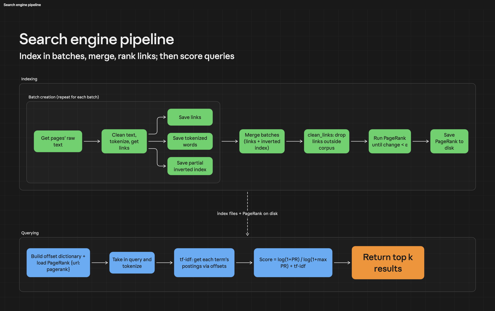

# search_engine
CS121 Assignment 3: create a search engine ground up

Group QEPS

Running order:
1. run `build_index.py`
2. run `post_index_creation.py`
3. Whenever you want to use query, run `query.py`

Current Working Diagram:
